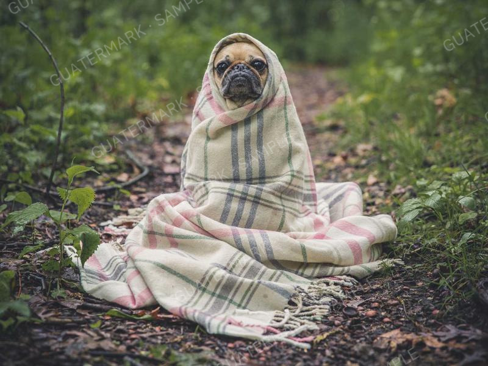
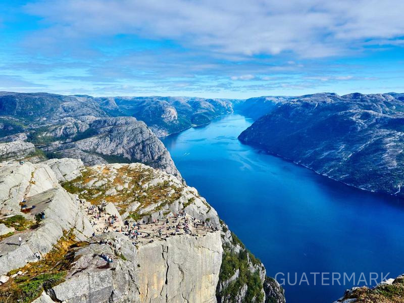
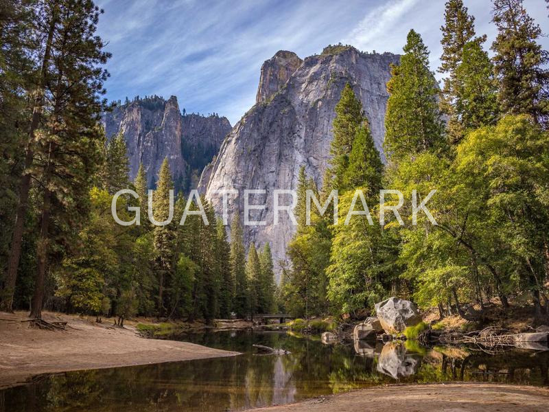

<div align="center">

# guatermark

**Watermark removal and image quality enhancement, 100% Rust.**

No Python. No ONNX. No models. No network at runtime.

[](https://github.com/jdsalasca/guatermark/actions/workflows/ci.yml)
[](LICENSE)

</div>

`guatermark` erases a watermark using a mask you provide, fills the hole from
the image's own texture, and can denoise / upscale / sharpen photos. It ships
with a reproducible, ground-truth benchmark on real photos, so every quality
claim below is measured, not guessed.

| Watermarked | Restored (`remove --algo fast`) |
|---|---|
|  |  |
|  |  |
|  |  |

## Quick start

```bash
git clone https://github.com/jdsalasca/guatermark
cd guatermark
cargo build --release

# Erase a watermark (mask: white / opaque = remove)
./target/release/guatermark remove input-examples/pug-tile.jpg out.png \
  --mask input-examples/masks/pug-tile.png

# Texture-preserving mode for larger marks (slower)
./target/release/guatermark remove input-examples/yosemite-logo.jpg out.png \
  --mask input-examples/masks/yosemite-logo.png --algo patch

# Quality: denoise + 2x Lanczos + luma unsharp
./target/release/guatermark enhance photo.jpg better.png \
  --denoise 0.5 --sharpen 0.65 --scale 2

# Make your own test watermarks / reproduce the examples
./target/release/guatermark stamp photo.jpg marked.jpg --text "SAMPLE" --style tile

# Rebuild input-examples, outputs and the HTML report
./target/release/guatermark eval
```

Rust 1.80+. Install globally with `cargo install --path .`.

## Commands

### `remove`

```
guatermark remove <input> <output> --mask <mask.png> [--algo fast|patch] [--grow N]
```

* **Mask format**: any PNG/JPG where white (or alpha) means "erase". A
  transparent PNG with an opaque watermark also works: opacity is the mask.
* `--algo fast` (default): multi-scale diffusion. Best for text, dates,
  usernames and other thin overlays. ~0.1 s for an 800×600 image.
* `--algo patch`: exemplar-based synthesis grown from the mask boundary.
  Keeps texture on bigger holes, but can leave visible patches; slower.
* `--grow 0` (default): mask size is respected exactly. If a light halo
  remains around thick/JPEG-compressed watermarks, use `--grow 1` or `2`.
  `--grow` is a square dilation of the mask.

Mask tips: draw it in GIMP/Krita/Photoshop (white = watermark, black =
keep), or select the watermark and export the selection. Keep it tight; one
or two pixels of margin is enough. `input-examples/masks/` contains ready
masks for every sample image.

### `enhance`

```
guatermark enhance <input> <output> [--denoise 0..1] [--sharpen 0..2] [--scale 1..8]
```

Pipeline: bilateral denoise → Lanczos3 upscale → luma-only unsharp mask.
Defaults are `--denoise 0.3 --sharpen 0.5 --scale 1`; the measured pipeline
in the benchmark is `0.5 / 0.65 / 2`.

### `stamp`

```
guatermark stamp <input> <output> [--text "SAMPLE"] [--style corner|tile|logo] [--alpha 0.35]
```

Synthetic, reproducible watermarks (text is rendered with the bundled IBM
Plex font). Used to build `input-examples/` and to benchmark removal against
known ground truth. `--save-mask out.png` also writes the exact affected
pixels.

### `eval`

```
guatermark eval [--dir eval] [--examples input-examples]
```

Reads `eval/clean/*.jpg`, stamps three watermark styles, removes them with
both algorithms and two mask sizes (exact and +2 px), benchmarks enhancement,
writes `eval/results.json`, `eval/report.html` and all output images, and
regenerates `input-examples/` + masks. The clean photos are the ground truth,
so PSNR/SSIM measure how much of the original image is actually recovered.

## Measured results

Setup: 6 real photos (800×600), 3 watermark styles (corner text, diagonal
tile, large centred logo), white overlay at alpha 0.38 / 0.24 / 0.55, saved
as JPEG q92. 72 removal cases, 18 enhancement cases. `ROI` is the watermark
bounding box; “PSNR on mark” only counts watermark pixels. Times are wall clock on the development machine and vary with load.

### Watermark removal

| Configuration | ROI PSNR before | after | gain | ROI SSIM | time |
|---|---:|---:|---:|---:|---:|
| **fast + exact mask** | 23.26 dB | **33.08 dB** | **+9.82 dB** | **0.926** | ~0.1 s |
| patch + exact mask | 23.26 dB | 30.81 dB | +7.55 dB | 0.897 | ~0.5 s |
| fast + mask grown 2 px | 23.26 dB | 27.32 dB | +4.06 dB | 0.826 | ~0.1 s |
| patch + mask grown 2 px | 23.26 dB | 26.30 dB | +3.05 dB | 0.797 | ~0.7 s |

On the watermark pixels themselves, diffusion goes from 13.7 dB to 27.9 dB
(corner), 20.6 dB to 24.8 dB (tile) and 10.5 dB to 22.9 dB (logo) for the
exact-mask cases. Visual inspection matters as much as PSNR: on thin text the
watermark is gone; on a large logo over detailed foliage the fill is
plausible but not invisible.

**Which algorithm?** Diffusion wins on thin overlays, both visually and in
PSNR. Patch synthesis is there for larger marks where averaging would turn
texture into mush; it preserves detail but can leave block-level artifacts.

### Quality enhancement

Degradation: 2× box downscale + Gaussian noise (σ = 5). Baselines restore the
same way without denoise/sharpen.

| Method | PSNR | SSIM | time |
|---|---:|---:|---:|
| nearest upscale | 28.38 dB | 0.805 | ~0 s |
| Lanczos3 upscale | 29.64 dB | 0.840 | ~0.1 s |
| **guatermark** (denoise + Lanczos + unsharp) | **30.08 dB** | **0.861** | ~0.3 s |

That is **+0.44 dB and +0.021 SSIM over a plain Lanczos upscale**, with the
difference visible as cleaner noise and crisper edges.

Full per-image tables, side-by-side images and the exact commands are in
[`eval/report.html`](eval/report.html) (open it locally; images are relative).
Raw numbers: [`eval/results.json`](eval/results.json).

## How it works

**Watermark removal** is inpainting, not blurring. The input is split into a
Gaussian/Laplacian-style pyramid; masked pixels are filled from known
neighbours at the coarsest level and refined with Jacobi diffusion at every
scale. This is why thin letters disappear without a smudge: the fill is
constrained by all the known pixels around them. The `patch` mode instead
walks the hole from its boundary inwards, matches 7×7 source patches outside
the mask, and copies their centres while propagating offsets from filled
neighbours (Criminisi-style exemplar synthesis).

**Enhancement** is classical image processing: a bilateral filter for
edge-preserving denoising, separable Lanczos3 resampling with negative lobes
for sharp upscaling, and an unsharp mask applied only to luminance to avoid
colour fringes.

**Metrics** are RGB PSNR and luminance SSIM (11×11 Gaussian, σ = 1.5),
computed over the whole ROI, the watermark pixels, and the full image. All
runs are deterministic (fixed seeds), so results are reproducible.

## Limitations

* **A mask is required.** Automatic detection of arbitrary watermarks is an
  open research problem; guessing masks produced unacceptable false positives,
  so the feature was removed instead of shipped half-working. Crop/draw the
  mask once per watermark.
* No semantic understanding: a large, opaque logo over a busy texture cannot
  be reconstructed exactly. Expect plausible texture, sometimes visible
  patches. The benchmark includes this hard case on purpose.
* The benchmark uses synthetic white overlays on six photos. It measures
  fidelity to a known original, not subjective beauty, and real watermarks
  vary in colour, opacity, shadows and compression.
* Very large images work but cost time/memory linearly; 800×600 is the tested
  size.

## Use responsibly

Only remove watermarks from images you own or are authorised to edit
(your own exports, purchased stock with a licence that allows it, public
domain material, etc.). Removing someone else's watermark can infringe
copyright. The authors do not condone that use.

## Project layout

```
src/
  main.rs        CLI (remove / enhance / stamp / eval)
  inpaint.rs     diffusion + exemplar-based inpainting
  enhance.rs     bilateral, Lanczos3, unsharp, degradation for benchmarks
  mask.rs        mask loading/saving/dilation
  metrics.rs     PSNR, SSIM, bounding boxes
  watermark.rs   synthetic watermark renderer (bundled IBM Plex)
  eval.rs        reproducible benchmark + HTML report
eval/
  clean/         six clean ground-truth photos
  out/           generated restorations and enhancement results
  report.html    visual report    results.json  raw metrics
input-examples/
  *.jpg          watermarked examples (corner, tile, logo)
  masks/         exact masks for every example
assets/          IBM Plex Sans + OFL licence
```

## Development

```bash
cargo fmt --check
cargo clippy --all-targets -- -D warnings
cargo test
cargo run --release -- eval
```

Tests cover PSNR/SSIM, mask dilation, watermark stamping, hole filling,
determinism, denoising and upscaling. CI runs the same checks on Ubuntu.

Commit messages follow Conventional Commits and are validated by commitlint
(`.commitlintrc.json`).

## License and credits

Code: MIT. Bundled font: IBM Plex Sans, SIL OFL 1.1. Sample photos: Unsplash
via Lorem Picsum — see [ATTRIBUTION.md](ATTRIBUTION.md).
